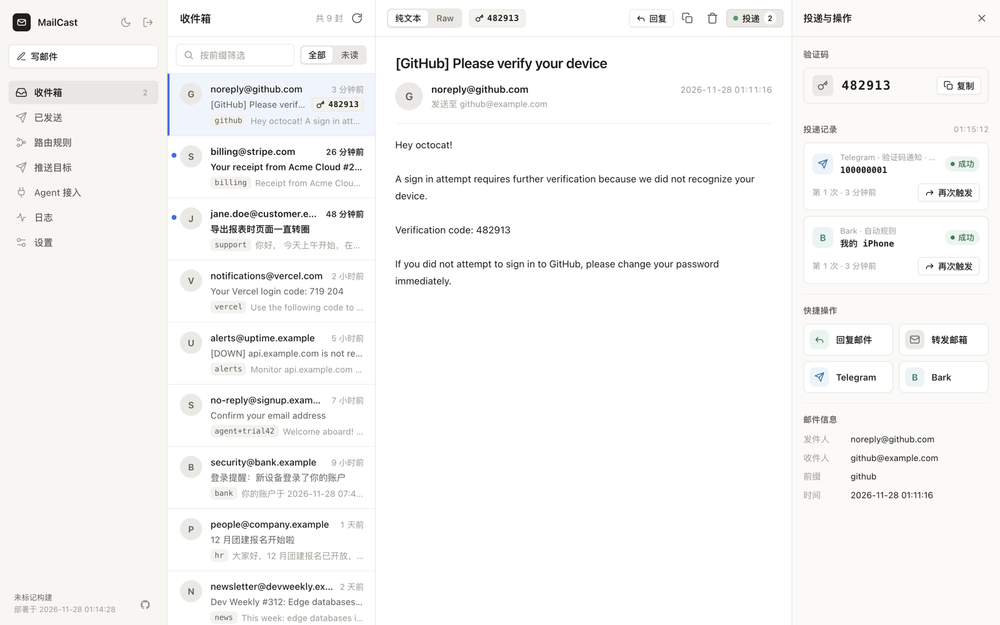
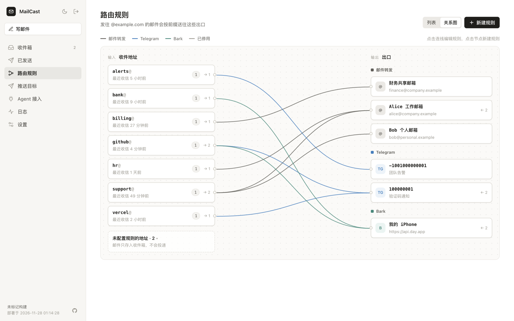
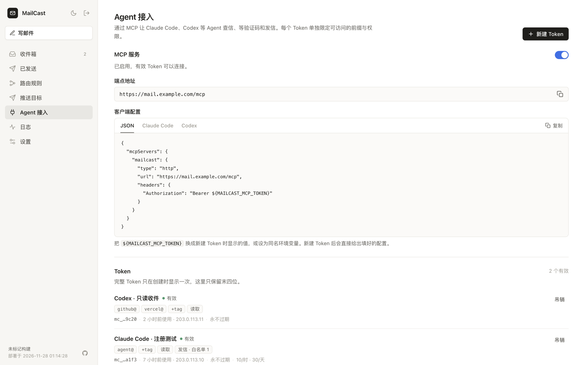
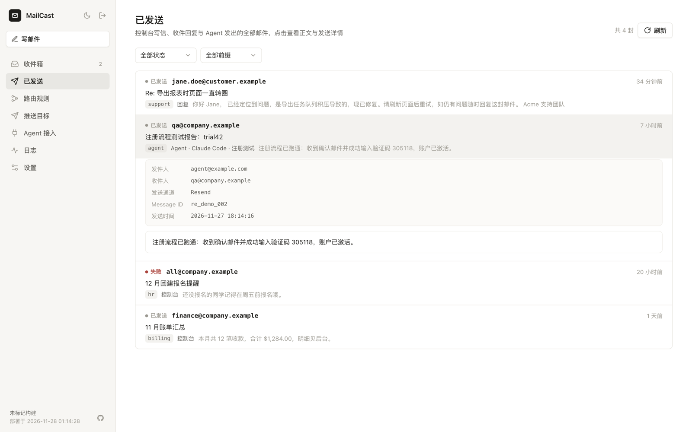

<div align="center">

# MailCast

**Turn your domain's mail into a programmable inbox**

Route mail by address prefix to email, Telegram and Bark, and let AI agents read verification codes and send mail safely.<br>
Runs entirely in your own Cloudflare account on Workers + D1. No servers.

[](https://deploy.workers.cloudflare.com/?url=https://github.com/LiaoGuoYin/mailcast)

[简体中文](./README.md) · English

</div>



> The console UI is in Chinese. Screenshots use fictional demo data.

## Why MailCast

**You own a domain but don't want to run a mailbox just to receive mail.**
You sign up with addresses like `github@`, `bank@` and `shop@`, yet only verification codes and a few alerts matter. MailCast receives mail for the whole domain, keeps everything in one searchable inbox, and pushes the important parts to your phone by prefix: codes to Telegram, bank alerts to Bark, everything else quietly archived.

**Let an agent finish "sign up → get the code → report back" on its own.**
When Claude Code or Codex runs an end-to-end test or a sign-up flow, it gets stuck at "check your inbox for the code". MailCast ships an MCP server: the agent can wait for new mail, read the body and candidate codes, then send a report. Each token only sees the prefixes it was granted, and sending is bound by a recipient allowlist and rate limits, so the agent never gets your whole mailbox.

**One domain, several team inboxes.**
Forward `support@` to two teammates, `billing@` to a shared finance mailbox and `hr@` to one person. No paid seat per person, replies go out from the matching prefix, and every outgoing message is logged.

## Features

### Prefix routing you can see at a glance

Each prefix can fan out to several destinations: any email address (re-sent through Resend, so targets don't need verifying one by one), Telegram bots and Bark. The graph view shows which address goes where and when each address last received mail. Addresses without a rule are stored in the inbox and not delivered anywhere.



### Notifications that keep only what matters

Before pushing to Telegram or Bark, MailCast strips HTML/CSS noise and condenses the message. Optionally, Cloudflare Workers AI or any OpenAI-compatible API can extract verification codes and write a one-line summary. Every destination of every email records its delivery result; failures show the reason and can be retried.

### Agent access over MCP

A built-in Streamable HTTP MCP endpoint (`/mcp`), with one-click config for Claude Code, Codex or plain JSON. Tools:

| Tool | Purpose |
|---|---|
| `get_mailbox_info` | Token scope, usable addresses, send quota and the latest email cursor |
| `wait_for_email` | Wait for a matching new email and return candidate codes directly |
| `list_emails` / `get_email` | Filter by prefix, sender or subject, and read messages |
| `send_email` / `reply_email` | Send or reply from a granted prefix, with idempotency keys |
| `list_sent_emails` | List the token's own sent mail and its status |

Each token is scoped separately: allowed prefixes (optionally `prefix+tag` sub-addresses), read / send permissions, a recipient allowlist, and hourly and daily send caps. The full token is shown only once, at creation.



### Send and receive in one console

Reply straight from the inbox; the reply goes out from the prefix that received the original. You can also compose from any prefix. The Sent page lists everything sent from the console, from replies and by agents, filterable by status and prefix, and each row expands to show the body, provider and failure reason.



### Also

- Activity log for deliveries, rule changes and agent calls
- Responsive layout, so rules and mail are manageable from a phone
- Light and dark themes
- A single admin password (the `ADMIN_PASSWORD` secret), resettable from the Cloudflare dashboard

## How it works

```text
Sender ──► Cloudflare Email Routing ──► MailCast Worker ──► D1 (mail, rules, logs)
                                              │
                                              ├──► Email (Resend or Cloudflare Email Sending)
                                              ├──► Telegram
                                              └──► Bark

Claude Code / Codex ──MCP──► MailCast Worker (read and send within the token's prefixes)
```

Cloudflare Email Routing handles inbound mail, and MailCast never touches your MX records. Outbound mail goes through the Resend API by default. All data lives in D1 under your own account.

## Quick start

1. **Deploy**: click **Deploy to Cloudflare** above and let it create the Worker and D1 database.
2. **Set a password**: in the Worker's **Settings → Variables and Secrets**, add the secret `ADMIN_PASSWORD` (8–256 characters, no whitespace), then open the `*.workers.dev` URL and sign in.
3. **Connect your domain**: enable Email Routing for your domain in Cloudflare and route the catch-all address to this Worker.

After signing in, a "Getting started" checklist at the top of the inbox tracks each step: first email received, first routing rule, outbound mail configured. Telegram- or Bark-only setups can skip outbound mail; to forward to email addresses or reply, connect Resend by following the guide.

Full steps are in the [deployment guide](./DEPLOYMENT.md) (Chinese):

- [Inbound domain setup](./DEPLOYMENT.md#配置收件域名)
- [Email forwarding via Resend](./DEPLOYMENT.md#配置邮件转发默认-resend)
- [Admin password and reset](./DEPLOYMENT.md#管理密码与忘记密码)
- [Auto-updating multiple instances (Workers Builds)](./DEPLOYMENT.md#多实例自动更新workers-builds)

> The Deploy Button requires a public source repository. If you share the button from your own copy, point its URL at a public copy.

## Local development

Copy `.dev.vars.example` to the git-ignored `.dev.vars`, set `ADMIN_PASSWORD` to your own local password (8–256 characters, no whitespace), then run:

```bash
cp .dev.vars.example .dev.vars
pnpm install
pnpm db:init:local
pnpm dev
```

The console front end is TypeScript under `web/`. `pnpm dev` and every deploy compile it into `public/` first; the output isn't committed, and `pnpm build` compiles it on its own.

The Workers AI binding connects to the remote service even locally, so run `wrangler login` before `pnpm dev`. If your login has several Cloudflare accounts, pick one: `CLOUDFLARE_ACCOUNT_ID=<account id> pnpm dev`.

Never commit real passwords or tokens.
