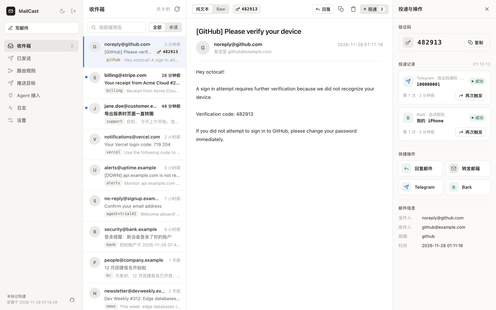
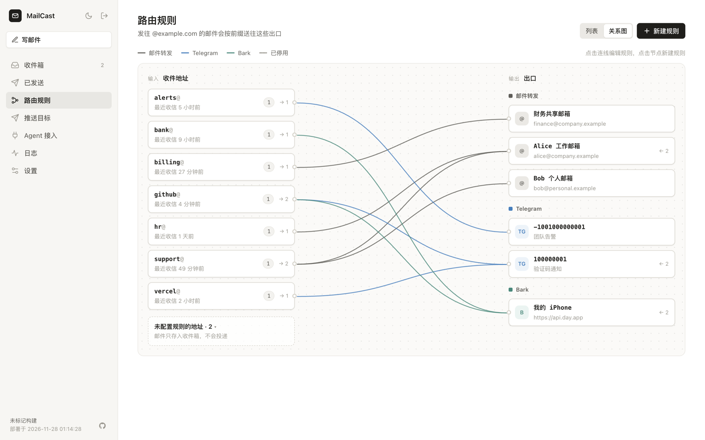
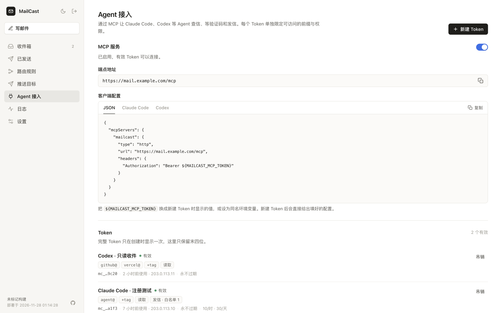
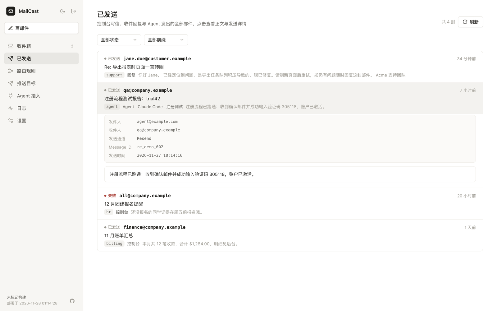

<div align="center">

# MailCast

**把你的域名邮箱变成一个可编程的收发中心**

按收件前缀把邮件分发到邮箱、Telegram、Bark，也让 AI Agent 安全地收验证码、发邮件。<br>
完全运行在你自己的 Cloudflare 账户里：Workers + D1，无需服务器。

[](https://deploy.workers.cloudflare.com/?url=https://github.com/LiaoGuoYin/mailcast)

简体中文 · [English](./README.en.md)

</div>



## 解决什么问题

**有自己的域名，但不想为收信再养一个邮箱服务。**
`github@`、`bank@`、`shop@` 这类注册用地址很多，真正要看的却只有验证码和几条提醒。MailCast 接管整个域名的收件，所有邮件存进一个可搜索的收件箱，再按前缀把重要的推到手机：验证码进 Telegram，银行提醒进 Bark，其余安静归档。

**让 Agent 自己完成「注册 → 收验证码 → 回报结果」。**
Claude Code、Codex 跑自动化测试或注册流程时，卡在「去邮箱看一下验证码」。MailCast 内置 MCP 服务，Agent 可以等待新邮件、读取正文和候选验证码、再发信汇报。每个 Token 只能看到被授权的前缀，发信受收件人白名单和频率限制约束，不会把整个邮箱交出去。

**一个域名，给小团队分出多个职能邮箱。**
`support@` 同时转给两位同事，`billing@` 进财务共享邮箱，`hr@` 只给负责人。不用给每个人开付费邮箱账号，也能从对应前缀直接回复客户，所有发件都留有记录。

## 功能

### 按前缀路由，一张图看清去向

每个收件前缀可以同时送往多个出口：任意邮箱（经 Resend 重新投递，目标无需逐个验证）、Telegram 机器人、Bark。关系图直接显示「哪个地址去了哪里」，以及每个地址最近一次收信时间；没配规则的地址只存入收件箱，不会投递。



### 推送只留重点

推送到 Telegram 和 Bark 前，会自动清理 HTML/CSS 噪声并压成摘要。可选接入 Cloudflare Workers AI 或任意 OpenAI 兼容接口，提取验证码、生成一句话摘要。每封邮件的每个出口都记录投递结果，失败可以查看原因并重试。

### Agent 接入（MCP）

内置 Streamable HTTP 的 MCP 端点（`/mcp`），控制台一键复制 Claude Code、Codex 或通用 JSON 配置。提供的工具：

| 工具 | 用途 |
|---|---|
| `get_mailbox_info` | 查看 Token 权限、可用地址、发信额度和最新邮件游标 |
| `wait_for_email` | 等待符合条件的新邮件到达，直接返回候选验证码 |
| `list_emails` / `get_email` | 按前缀、发件人、主题筛选和读取邮件 |
| `send_email` / `reply_email` | 从授权前缀发信或回复，带幂等键防重复 |
| `list_sent_emails` | 查看自己发出的邮件及状态 |

每个 Token 单独限定：可访问的前缀（可选允许 `prefix+tag` 子地址）、读 / 发权限、收件人白名单、每小时与每日发信上限。完整 Token 只在创建时显示一次。



### 收发都在一个控制台

收件箱可以直接回复，回信会从原收件前缀发出；也可以从任意前缀写新邮件。「已发送」列出控制台、回复和 Agent 发出的全部邮件，可按状态和前缀筛选，展开就能看到正文、发送通道和失败原因。



### 其他

- 操作日志：投递、规则变更、Agent 调用都会记录
- 响应式界面，手机上也能管理规则、查看邮件
- 浅色 / 深色主题
- 单一管理密码（`ADMIN_PASSWORD` Secret），在 Cloudflare 网页即可重置

## 工作原理

```text
发件人 ──► Cloudflare Email Routing ──► MailCast Worker ──► D1（邮件、规则、日志）
                                              │
                                              ├──► 邮箱（Resend 或 Cloudflare Email Sending）
                                              ├──► Telegram
                                              └──► Bark

Claude Code / Codex ──MCP──► MailCast Worker（按 Token 授权的前缀读信、发信）
```

收信由 Cloudflare Email Routing 负责，MailCast 不修改你的 MX；发信默认走 Resend API。所有数据都存在你自己账户下的 D1 里。

## 快速开始

1. **部署**：点上方 **Deploy to Cloudflare**，按提示创建 Worker 和 D1。
2. **设置密码**：在 Worker 的 **Settings → Variables and Secrets** 添加 Secret `ADMIN_PASSWORD`（8–256 位，不含空白），打开 `*.workers.dev` 地址登录。
3. **接入域名**：在 Cloudflare 为你的域名启用 Email Routing，把 Catch-all 路由到这个 Worker。

登录后，收件箱顶部的「开始使用」清单会逐项检测：收到第一封邮件、添加路由规则、配置发信。只用 Telegram 或 Bark 推送时不需要配置发信；要转发到邮箱或回复邮件，再按指南接入 Resend。

详细步骤见 [部署指南](./DEPLOYMENT.md)：

- [配置收件域名](./DEPLOYMENT.md#配置收件域名)
- [配置邮件转发（Resend）](./DEPLOYMENT.md#配置邮件转发默认-resend)
- [管理密码与忘记密码](./DEPLOYMENT.md#管理密码与忘记密码)
- [多实例自动更新（Workers Builds）](./DEPLOYMENT.md#多实例自动更新workers-builds)

> Deploy Button 要求源仓库公开。若从自己的副本分享部署按钮，请把按钮 URL 中的仓库地址换成公开副本地址。

## 本地开发

把 `.dev.vars.example` 复制为被 Git 忽略的 `.dev.vars`，把 `ADMIN_PASSWORD` 改成你自己的本地开发密码（8–256 位，不含空白字符），然后运行：

```bash
cp .dev.vars.example .dev.vars
pnpm install
pnpm db:init:local
pnpm dev
```

控制台前端源码是 `web/` 下的 TypeScript，`pnpm dev` 和每次部署都会先把它编译到 `public/`；编译产物不入库，需要单独编译时运行 `pnpm build`。

Workers AI binding 在本地也会连接远程服务，所以 `pnpm dev` 需要先 `wrangler login`。如果登录的账号下有多个 Cloudflare 账户，再指定其中一个：`CLOUDFLARE_ACCOUNT_ID=<账户 ID> pnpm dev`。

不要把真实密码或 Token 提交到 Git。
